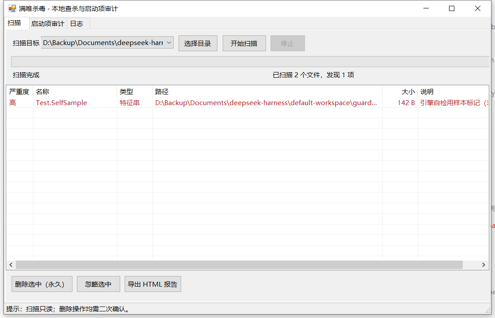
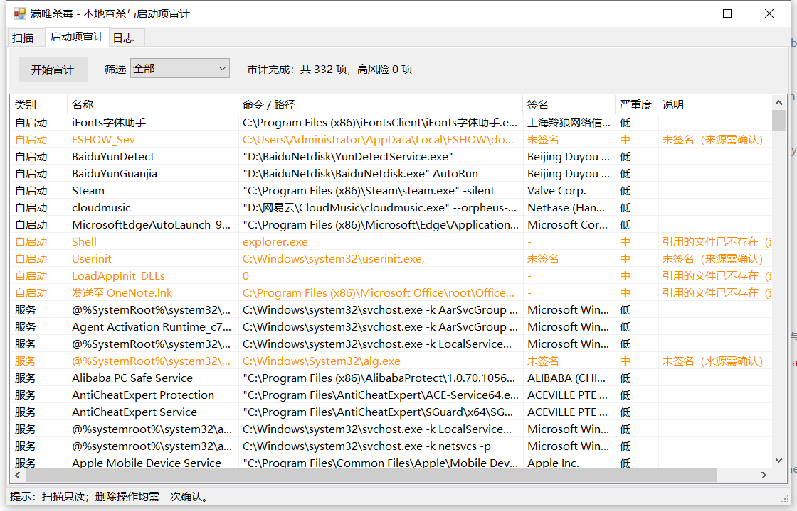

# 满唯杀毒

[](https://github.com/wwl105482-ux/manwei-av/actions/workflows/build.yml)

轻量级本地查杀与启动项审计工具（Windows，单 exe，无需安装）。

满唯杀毒 是一个自己写的"小杀毒软件"：不联网、无内核驱动、无后台常驻防火墙，只做两件事——
**扫描本机文件** + **审计系统里的自启动位置**。适合用来快速检查"电脑里有没有奇怪的东西"，
不能替代 Windows Defender 这类真正的杀毒软件。



## 功能


**扫描**
- 快速扫描：Temp、下载、桌面、AppData\Roaming、ProgramData、启动文件夹、Public，**并自动覆盖其它固定磁盘（D: 等）的 Temp / 缓存 / 下载类目录**（如 `Cache`、`QMDownload`、`QLDownload`、`qycache`、`Backup\Downloads`）
- 全盘扫描（C、D 或自选盘）
- 自选目录扫描

**检测手段**
- 哈希（MD5）匹配已知样本
- 文件内特征串匹配（文本 + 二进制）
- 文件名 / 路径规则（如 `playfinder`、`360safe`、`ludashi`）
- 脚本行为规则：把多条可疑动作组合起来判定，例如“下载远程内容 + 立即执行（IEX）”“删除卷影副本 + 关闭启动修复”“关闭 Defender 实时防护 / 清空事件日志”；同一条规则要命中至少 2 个动作才报（`MinHits`），单个关键词不报，降低误报
- 宏文档检测：Office 容器（.docm/.xlsm/.pptm 等）里含有 `vbaProject.bin` 时读取宏工程内容并按危险调用分级：命中 3 类以上（AutoOpen/Document_Open、Shell/CreateObject、URLDownloadToFile/MSXML2、powershell/cmd、Environ/FileCopy/Kill 等）报高危 `Doc.VbaMacro.Suspicious`，1–2 类报中危，没有危险调用只提示“带宏文档”（中危，归入疑似垃圾，需人工确认）
- 脚本编码载荷：`-EncodedCommand` / `-enc` 后的 base64、以及脚本里的 base64 字面量会先解码再匹配（单文件最多 2 MB），避免“编码一层就绕过”
- **Windows Defender 二次复核**：扫描结束后，把“疑似垃圾”里的文件（最多 20 个）交给系统自带 Defender 的 `MpCmdRun.exe` 再判一次，只报告、不删除（`-DisableRemediation`）。复核在后台进行，不阻塞结果展示；单文件 15 秒超时、整批 60 秒封顶、4 路并行，结论按“路径 + 大小 + 修改时间”缓存 7 天。Defender 判为威胁的条目会自动升为高危并移入“放心删”，说明列追加“Defender 检出威胁 / 未检出 / 超时 / 失败”。压缩包内部条目（虚拟路径）无法单独提交，会跳过并在日志里注明。
- 启发式：PE 加壳（UPX/MPRESS/Themida）、节区高熵（疑似加密/压缩壳）、双扩展名（`发票.pdf.exe`）、隐藏的 exe、风险目录（Temp/启动项/盘根）中未签名的可执行文件

**启动项审计**（这一页往往比扫描更有用）
- 注册表 Run / RunOnce（HKCU + HKLM + Wow6432Node）
- Winlogon Shell / Userinit、AppInit_DLLs、IFEO Debugger
- 启动文件夹（含 .lnk 目标解析）
- 服务（非驱动类）、计划任务（解析 `System32\Tasks\*.xml`）
- hosts 文件的非回环映射、Chrome/Edge/Brave 扩展
- 显示每项的**数字签名**（签名者/是否未签名）与严重度，可右键定位到注册表、文件或任务
- 选中一项后点顶部 **删除选中** 按钮，或直接按 `Delete` 键，二次确认后删除该启动项/服务/计划任务

**其他**
- 结果列表带**「磁盘」列**，直接标出每条结果来自 C: / D: / 其他盘；**「路径」列放在最右侧**，不挤占前面的信息
- 查杀结果按可信度分两组：**放心删**（哈希命中、特征串命中等内容级证据）和**疑似垃圾**（仅凭文件名、路径或启发式判定，可能是误报），分组标题带条数与体积
- **全选**：汇总行右侧的「全选」按钮（点一次变「取消全选」），或列表里按 `Ctrl+A`
- 汇总行上「放心删」「疑似垃圾」两边各有一个小方框，勾上只选中该分组的行，适合"整组删放心删、剩下的逐条看"
- 两张列表底部都有**详情栏**：选中任意一行，完整路径与说明会显示出来（不受列宽省略号限制）；右键可选「复制完整路径」或「自动调整列宽」把整列内容撑开
- 删除选中（永久删除，有二次确认；**没有隔离区，删了就找不回**）
- 导出 HTML 报告到 `Reports\满唯杀毒-<时间戳>.html`
- 最小化时正常收进任务栏（不弹提示），托盘图标同时保留，双击托盘可恢复窗口；点右上角 × 退出程序
- 结果列表上方有**筛选框**（按名称/类型/说明/路径包含的关键字即时过滤，分组与计数跟着变），点列头可**排序**（再点一次反向）
- 托盘右键还提供：**暂停扫描 / 继续扫描**（扫描中可用）、**导入规则包...**（离线更新规则，无需重装）、**关于 满唯杀毒**（含程序 SHA256 与规则完整性状态）、**导出诊断信息...**
- 规则完整性：启动时比对规则文件 SHA256 与随程序发布的值，不一致会在日志里提示“当前规则文件与随程序发布的版本不同”（导入自定义规则后属正常）
- 扫描结束日志会给出**用时与速度**（`用时 12.3 秒（820 文件/秒）`），方便判断是盘慢还是规则重
- 桌面通知（扫描发现威胁时弹气泡）**默认关闭**，可在托盘右键菜单"显示桌面通知"里手动打开，开关会记到 `满唯杀毒.settings.json`



## 运行

1. 双击 `dist\满唯杀毒.exe`，UAC 弹窗选择"是"（需要管理员权限才能读取全部服务的启动项和 system 目录）。
2. 「小文件」页选范围 → **开始扫描**（只查 50 MB 以内的文件）；双击或右键结果可定位文件。**彻底扫描默认不勾选**：勾选后缓存目录与素材文件也会逐个读内容，行为规则读全文且不做关键词预筛（更慢、但更全）；平时保持不勾选就是快速扫描。开关状态记到 `满唯杀毒.settings.json` 的 `ThoroughScan`。
3. 审计页点 **开始审计**，等几秒看列表；选中一项后点 **删除选中**（或按 `Delete` 键）可删除，右键可定位/复制/删除。

命令行（无界面，适合脚本/定时任务）：

```
满唯杀毒.exe --selftest         # 自检：规则加载、样本命中、误报、启发式
满唯杀毒.exe --scan <目录>       # 扫描并输出 THREAT|... 与 SUMMARY|...
满唯杀毒.exe --scan --thorough <目录>  # 彻底扫描（不跳缓存/素材，行为规则读全文）
满唯杀毒.exe --defender-check <文件>   # 只问 Defender 一个文件的结论（诊断用，不删除）
满唯杀毒.exe --defender-batch <目录>   # 扫描目录后对“疑似”项做批量 Defender 复核（诊断用）
满唯杀毒.exe --gui-scan <目录>   # 打开界面并自动扫描
满唯杀毒.exe --gui-audit         # 打开界面并自动开始启动项审计
满唯杀毒.exe --info              # 打印系统/权限/.NET/规则/配置目录/Defender/屏幕信息（排障用）
满唯杀毒.exe --diag [文件]        # 输出系统/规则/配置/Defender 诊断信息，可同时写到文件
满唯杀毒.exe --check-rules <文件>  # 校验规则包（JSON 结构 + 正则能否编译），输出 CHECK|ok 或 CHECK|fail
满唯杀毒.exe --import-rules <文件> # 导入规则包（自动备份旧规则，失败自动回滚）
```

## 安装包（推荐分发用）

`dist\满唯杀毒-安装程序.exe` 是自带的安装向导，单文件，内置主程序与规则文件：

1. 双击运行，UAC 选“是”；未签名时可能先看到“未知发布者”提示，点“运行”。
2. 有管理员权限时默认装到 `C:\Program Files\满唯杀毒`（写入所有用户）；没有管理员权限时默认装到 `%LOCALAPPDATA%\Programs\满唯杀毒`，同样会出现在“应用”列表里，功能一致。可点“浏览”换目录；可勾选桌面快捷方式、开始菜单快捷方式、安装完成后启动。
3. 安装完成后，“设置 → 应用 → 已安装的应用”（Win10 为“应用和功能”）里会出现“满唯杀毒 - 本地查杀与启动项审计”，可直接卸载；也可以运行安装目录里的 `Uninstall.exe`。
4. 静默安装：`满唯杀毒-安装程序.exe /S /D=C:\Tools\满唯杀毒`；静默卸载：`Uninstall.exe /S`（会保留配置与 `Reports\`）。
5. 覆盖安装即可升级；卸载时选择保留配置，`满唯杀毒.settings.json` 与 `Reports\` 会留在原目录。

装到 `Program Files` 这类不可写目录时，配置与报告会自动改存 `%LOCALAPPDATA%\满唯杀毒`（见下一节）。

### 下载与使用常见问题

- **“Windows 已保护你的电脑”/ SmartScreen 拦截**：程序没有数字签名，点“更多信息 → 仍要运行”。
- **“无法验证发布者 / 未知发布者”**：同样点“运行”；也可右键文件 → 属性 → 勾“解除锁定”，或执行 `Unblock-File .\满唯杀毒-安装程序.exe`。这两个提示只说明没有代码签名证书，不代表文件有毒。
- **被杀毒软件报毒或装到一半安装包/程序消失**：查杀类工具容易被别的杀软误报。把安装包和安装目录加入白名单后再装；安装时若弹拦截，选“允许”。安装程序发现主程序没写成功时也会提示这个原因。
- **没有管理员权限**：安装程序默认装到 `%LOCALAPPDATA%\Programs\满唯杀毒`，只对当前用户生效，同样出现在“应用”列表。如果这台电脑已有“所有用户”版本，请先让管理员卸载，否则会提示先卸载再装。
- **系统要求**：Windows 10 / 11 + .NET Framework 4.5+（系统自带 4.8）；Win7/8 不支持。安装目录过长（>180 字符）或磁盘不足 50 MB 会被拒绝。
- **装完在“应用”里找不到**：在“设置 → 应用 → 已安装的应用”搜“满唯杀毒”；卸载也在这里，或运行安装目录下的 `Uninstall.exe`。
- **扫描慢**：取消“彻底扫描”勾选可回到快速扫描（缓存目录/素材不读内容，行为规则只看前 64 KB）。
- **重复安装/换作用域**：用户级与所有用户级会自动互斥，覆盖安装会清掉另一份的快捷方式、注册表项和默认目录。
- **其他问题**：运行 `满唯杀毒.exe --info`，把输出发给开发者；也可以右键托盘图标 → **导出诊断信息...**，把生成的 txt 发过来。

### 版本、诊断与发布物料

- 版本号：`src\AssemblyInfo.cs` 的 `AssemblyVersion` 与 `Program.AppVersion` 保持一致（当前 1.0.0）。托盘右键 → **关于 满唯杀毒** 可看到版本、规则库计数、构建时间、配置目录和当前权限。
- 诊断：`满唯杀毒.exe --diag [文件]` 输出同样的诊断文本；托盘右键 → 导出诊断信息 会写到 `Reports\满唯杀毒-诊断-<时间>.txt` 并自动定位文件。
- 启动提权：首次以普通用户启动时询问是否以管理员重启；勾选“记住我的选择”后写入 `满唯杀毒.settings.json` 的 `Elevation`（`ask` / `always` / `never`），之后可在托盘或设置文件里改回。
- 发布物料：`EULA.txt`、`PRIVACY.txt`、`CHANGELOG.md`、`推广文案.md` 随仓库提供；运行 `release.ps1` 会重新构建主程序与安装包、组装 `dist\满唯杀毒-1.0.0-portable.zip`，并生成 `dist\SHA256SUMS.txt`（UTF-8 带 BOM，Windows 工具打开不乱码）。


## 在其他电脑上运行（Windows 10 / 11）

程序是绿色便携的，拷过去就能跑，但分发前请让对方知道这几件事：

- **系统要求**：Windows 10 / 11（32 位、64 位都行），自带 .NET Framework 4.5+（Win10/11 都是 4.8，无需安装）。不支持 Win7/8。
- **要带 `rules\signatures.json`**：少了它程序仍能启动，但会退回内置的极小规则集，查杀能力明显变弱。`tests\` 只有 `--selftest` 用得到，分发时不必带。
- **需要管理员权限**：UAC 弹窗要选“是”；拒绝或没有管理员账号时只能以普通用户运行，启动项/服务审计会不全。
- **放在可写目录**：设置与 `Reports\` 默认写在 exe 同目录。若放进了 `Program Files` 这类不可写位置，程序会自动改存到 `%LOCALAPPDATA%\满唯杀毒`，启动日志的“配置与报告目录”一行会写明实际位置，功能不受影响。
- **未签名会弹提示**：别人第一次运行可能看到“Windows 已保护你的电脑”（SmartScreen，点“更多信息 → 仍要运行”）或“无法验证发布者”的安全警告（点“运行”）。传输后也可让对方右键 exe → 属性 → 勾“解除锁定”，或执行 `Unblock-File .\满唯杀毒.exe`。
- **可能被系统策略直接拦下**：Win11 的“智能应用控制”、Windows S 模式、公司电脑的 AppLocker/WDAC 会禁止未签名程序，这类机器只能先签名或让管理员放行。第三方杀软也可能把本程序或 `tests` 里的样本误报为恶意。
- **Defender 二次复核依赖系统自带 Defender**：对方装了第三方杀软并把 Defender 关掉时，这一项会显示“复核失败/跳过”，其余功能不受影响。
- **小屏 / 高缩放**：窗口会按桌面工作区自动收缩，1366×768 或 125%/150% 缩放下也能完整显示；再小会偏挤，但不影响使用。
- **多用户共用**：同一台电脑多个 Windows 账号使用同一份程序目录时，共用同一份配置和报告目录。

排障时让对方运行 `满唯杀毒.exe --info`，把输出发回来即可看到系统版本、.NET 版本、是否管理员、规则库、配置目录、Defender 路径和屏幕尺寸。

## 规则文件

`dist\rules\signatures.json`，五类规则，`Severity` 取 `low`/`medium`/`high`：

```json
{
  "Version": "2026.11.20-1",
  "Hashes":  [{ "Md5": "44d886...", "Name": "EICAR.TestFile", "Severity": "high", "Description": "..." }],
  "Strings": [{ "Pattern": "example-marker", "Encoding": "ascii", "Name": "Example.String", "Severity": "medium", "Description": "..." }],
  "Names":   [{ "Regex": "playfinder|traplayfinder", "Name": "Adware.PlayFinder", "Severity": "high", "Description": "..." }],
  "Paths":   [{ "Regex": "\\\\temp\\\\[^\\\\]+\\.exe$", "Name": "...", "Severity": "medium", "Description": "..." }],
  "Behaviors": [{
    "Name": "Heur.ScriptDownloadCradle",
    "Severity": "high",
    "Extensions": ".ps1,.psm1,.bat,.cmd,.vbs,.js",
    "MinHits": 2,
    "Patterns": ["downloadstring|downloadfile|invoke-webrequest", "(^|[^a-z])iex([^a-z]|$)"],
    "Description": "脚本下载远程内容后立即执行"
  }]
}
```

`Encoding` 支持 `ascii` / `unicode`。`Behaviors` 的 `Patterns` 是正则数组，同一个文件命中其中至少 `MinHits` 条（默认 2）才报，单个关键词不单独报警；`Extensions` 限定生效的文件类型。规则文件缺失或损坏时程序会退回内置最小规则集，不会崩溃。

## 局限（重要）

- **没有实时监控**，不会拦截正在运行或即将写入的病毒，只能事后扫描。
- **没有隔离区**，删除是永久的。
- 没有云查杀和病毒库自动更新；规则是本地静态的，覆盖面有限（优势是断网也能用、不上传任何文件）。
- 行为规则是固定的模式组合，改写过的脚本（变量拼接、编码混淆、换用未收录的下载/执行方式）可能绕过；宏文档只判断"有没有 vbaProject.bin"，分不清正常宏和恶意宏。
- 启发式与行为规则都会误报（尤其对加壳的绿色软件、免安装工具、带宏的办公文档），这类结果归入“疑似垃圾”，删除前请自行确认。
- 不能替代 Windows Defender，建议两者同时保留：Defender 负责实时拦截与云查杀，满唯杀毒负责离线扫描、启动项审计和可疑脚本/宏的二次检查。程序里的“Defender 二次复核”只是把疑似文件交给 Defender 再问一次（只读、不删），**没有实时防护**；Defender 被移除/禁用时该功能自动跳过，不影响本地扫描。可在托盘右键菜单「Defender 二次复核」里随时关闭。

## 扫描性能与覆盖范围

- 线程数默认自动（取 CPU 逻辑核心数，最多 16），也可以在设置文件的 `Threads` 里固定线程数（0 表示自动）。
- 除下面列出的素材与缓存外，每个文件都会打开检查；二进制读头部 1.5 MB，脚本/文本类（.ps1 .bat .vbs .js .py .html .xml .json 等）读 4 MB，覆盖藏在脚本后半段的命令。
- MD5：4 MB 以内的文件全算；可执行文件（.exe .dll .sys .scr .ocx .cpl .com .drv .efi 等）放宽到 8 MB；位于高风险位置（临时目录、启动项、盘根等）的文件放宽到 64 MB。
- 压缩包/容器类（.zip .jar .apk .whl .nupkg .vsix .xpi .crx .docx .xlsx .pptx .epub）会解包检查：条目名按文件名规则匹配，8 MB 以内的小条目再读 256 KB 做特征串匹配；单包最多 32 MB / 2000 个条目，超过 512 MB 的包不解。
- 每个文件只打开一次、顺序读取，头部检测与哈希共用同一数据流；目录枚举也只走一遍。
- 快速扫描会跳过浏览器 / CEF 缓存目录（`Cache`、`Cache_Data`、`Code Cache`、`GPUCache`、`Service Worker`、`CacheStorage`、`ShaderCache`、`blob_storage` 等）：这些内容随时可重新生成，WPS 的 addons 一个目录里就有近 9000 个这类文件、1 GB。勾选彻底扫描时不跳过。
- 快速扫描时图片/字体/样式/媒体文件（.svg .png .jpg .gif .ico .webp .css .ttf .woff .mp3 .mp4 等）只做文件名与路径规则，不打开读内容、也不算 MD5；这类文件占 WPS 插件目录文件总数的六成以上，内容里几乎没有可执行代码。勾选彻底扫描时会照常读内容并参与哈希。
- 行为规则的读法取决于「彻底扫描」：勾选时脚本读满 4 MB、跳过关键词预筛、跑全部行为正则；取消勾选（快速扫描）时只读前 64 KB，并先用关键词（如 `downloadstring`、`certutil`、`vssadmin`、`mimikatz`）预筛，命中才跑正则组合，避免对压缩过的前端 JS 做全文正则（此前 18 个 1 MB 的 JS 就要 3 秒）。
- 勾选彻底扫描后同样取消“缓存目录跳过”和“素材不打开”：`Cache`、`Cache_Data` 等目录照常进入，`.svg .png .css .ttf .mp3` 等也会读内容并参与哈希。实测同一份 WPS 插件目录（58,391 个文件 / 4.4 GB）：快速扫描 8.8s，彻底扫描 29s；对“可疑命令藏在 64 KB 之后”的脚本、以及伪装成 `.svg` 的特征串样本，只有彻底扫描能报出。
- 特征串只对二进制与脚本/文本内容做匹配；`.log .txt .json .xml .ini .dat .db .csv .md .pdb .evtx` 这类"记录型"文件不做特征串匹配（其中的病毒名往往只是日志内容），但仍参与文件名/路径规则与哈希检查。
- 启发式（未签名/加壳/双扩展名/隐藏）只针对 `.exe .scr .com .cpl`，避免对系统 DLL、.mui 等海量文件误报。
- 扫描范围的下拉项是**按当前磁盘自动生成**的：快速扫描、全盘扫描 C:、全盘扫描 D:…、全盘扫描（所有磁盘）、自定义目录；以后加装新硬盘（如 E:），选项会在下次点开下拉框时自动出现，不用重装程序。默认只列本地固定盘；U 盘/移动硬盘需勾选「小文件」「大文件」两页「扫描范围」下方的「含可移动磁盘」复选框（或托盘右键「包含可移动磁盘」）后出现；三个入口是同一个开关，状态互相同步（默认关闭，避免误扫）。只处理 50 MB 以内的文件，更大的交给「大文件」页。
- 实测（本机 6 核 12 线程 / NVMe）：`C:\Windows\System32` 16,496 个文件 3.6s（0 误报）；`C:\Program Files (x86)` 29,216 个文件 3.4s；WPS 插件目录 `%APPDATA%\kingsoft\wps\addons` 58,395 个文件 / 4.4 GB：优化前 56s，优化后热扫描 2.2s（首次运行仍受 Defender 实时防护冷缓存影响，会明显更慢）。
- Defender 复核不计入扫描耗时：扫描结果先出来，复核在后台跑。本机实测单个文件约 40–60ms，两项合计 0.06s；命中缓存时整批约 5ms。最坏情况被“20 个上限 / 单文件 15 秒 / 整批 60 秒 / 4 路并行”封住。
- 结果里的"跳过"表示文件被占用或无权限读取，这类文件仍会参与文件名/路径规则判定。

## 大文件垃圾扫描

「大文件」标签页用来找占空间但没用的东西，和查病毒是两条独立的线：

- **扫描范围**：快速扫描（与「小文件」页相同的常见落地目录）、全盘 C:、全盘 D:、全盘扫描（所有磁盘）、自定义目录；托盘右键「包含可移动磁盘」打开后，U 盘/移动硬盘也会出现在列表里。
- **体积门槛固定为 50 MB**：只列出 50 MB 以上的文件；50 MB 以下的归「小文件」页扫，两边不重叠，避免同一个文件被两边重复列出（也就不需要再选体积档位）。
- 列表只显示有明确清理理由的"疑似垃圾"，普通大文件不列出（避免把系统组件、虚拟机盘、素材库当成垃圾）。
- 结果分两组显示："**放心删**"（崩溃转储、更新缓存、临时/缓存、超大日志——都能重新生成或重新下载，删了不影响系统）和"**疑似垃圾**"（旧安装包、旧镜像、备份残留、调试符号、跟踪日志——删前最好确认一下）。分组标题上直接标出条数与体积。
- 每条结果带**严重度**并用颜色区分：**高**（红色）= 放心删，**中**（橙色）= 疑似垃圾，和查杀页的配色保持一致。
- **识别规则**（按顺序判定，命中即归类）：崩溃转储 `.dmp/.mdmp/.hdmp`；系统更新缓存 `SoftwareDistribution\Download`；临时与缓存目录下的文件（`\temp\ \tmp\ \cache\ \crashdumps\ \livekernelreports\` 等）；下载目录里的旧安装包（.exe/.msi/.iso/.zip/.rar 等）；超过 180 天的系统镜像；`.bak/.old/.tmp/.temp/.orig` 备份残留；200 MB 以上的超大 `.log`；`.pdb` 调试符号；`.etl/.evtx` 跟踪与事件日志。
- **不会列入垃圾**：`C:\Windows\System32\winevt\Logs` 下的系统事件日志（删了会破坏审计记录），它们只在"所有大文件"模式下展示并标注"不建议删除"。
- 列表按体积从大到小排列，底部显示"合计可释放约 X"；支持全选、批量永久删除（二次确认显示条数与总大小）和"定位文件"（在资源管理器中选中）。
- 实测（本机）：C 盘 100 MB 垃圾模式约 9.5 秒，找出 5 个约 4.4 GB；D 盘 200 MB 全量模式 2 秒列出 109 个文件约 83.6 GB。

## 构建

需要 .NET Framework 4.x 自带的编译器（Windows 10/11 自带）：

```powershell
powershell -ExecutionPolicy Bypass -File build.ps1
```

输出 `dist\满唯杀毒.exe` 并复制 `rules`、`tests`。源码是 C# 5 语法，用 `csc /codepage:65001` 编译。

## 目录结构

```
guardscan\
  src\            源码（Model / Signatures / FileChecks / ScanEngine / Audit / MainForm / SelfTest / Program）
  installer\      安装程序（Setup.cs，生成带卸载项的安装包）
  rules\          特征规则
  tests\samples\  自检样本
  app.manifest    管理员权限 + DPI 感知
  build.ps1       编译主程序
  build-installer.ps1  编译安装包
  release.ps1     组装便携包与 SHA256SUMS
  deploy.ps1      便携部署到本机目录（可 -TargetDir 指定）
  dist\          输出目录（exe + rules + tests）
```

## 开源说明

English overview: [`README.en.md`](README.en.md)（供审核者/海外用户快速了解项目）。

- 许可证：**MIT**（见 `LICENSE`）。
- 贡献方式与构建要求：`CONTRIBUTING.md`；安全问题：`SECURITY.md`。
- CI：`.github/workflows/build.yml` 在 Windows 上构建、跑 `--selftest` 并上传产物。
- 代码签名：走开源免费方案（SignPath Foundation），申请与签名流程见 `docs/SIGNING.md`，签名工作流模板在 `.github/workflows/signpath.yml`。
- 本仓库不包含任何用户数据、日志、证书或私钥；`dist/`、`*.settings.json`、`*.pfx` 已被 `.gitignore` 排除。

